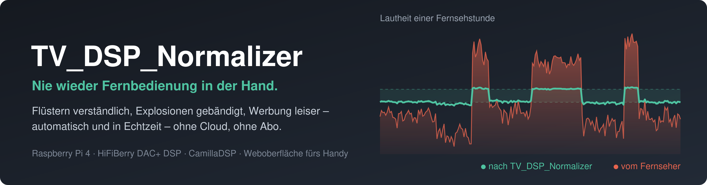
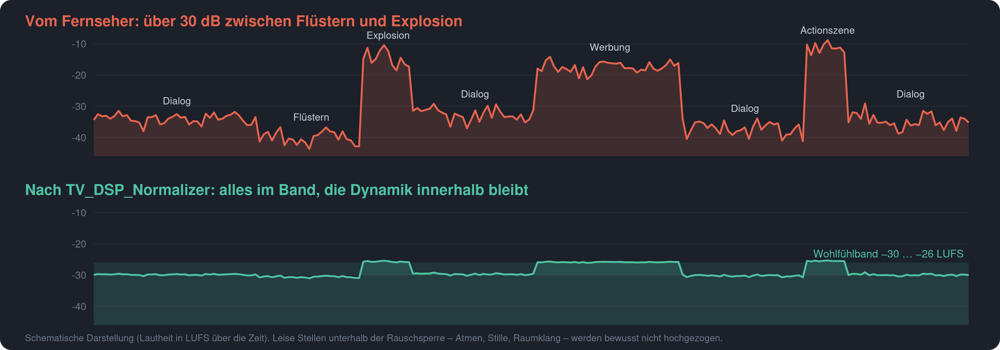
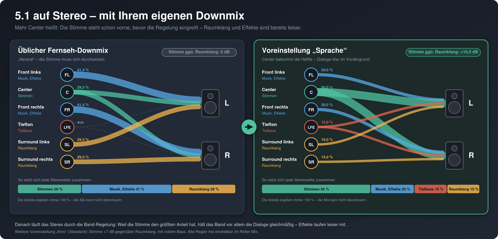
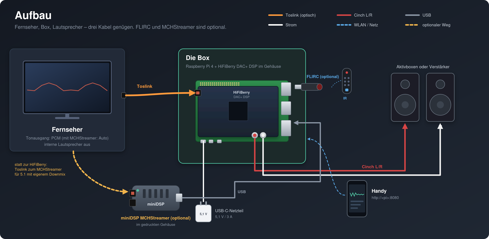

<p align="center">
  <a href="docs/bilder/readme/banner.png?raw=true"></a>
</p>

<p align="center">
  
  
  
  
  
  
  
</p>

<h3 align="center">Fernsehen in einer Lautstärke – egal, was gerade läuft.</h3>

<p align="center">
  Eine kleine Box zwischen Fernseher und Lautsprechern, die den Ton in Echtzeit ausgleicht.<br>
  Leise Dialoge werden verständlich, Explosionen und Werbung bleiben im Rahmen. Bedient wird sie vom Handy aus.
</p>

---

## Für alle, die die Lautstärke-Achterbahn satthaben

Sie kennen das: Im Film flüstern zwei Menschen, also drehen Sie lauter. Drei Sekunden später fliegt ein
Auto in die Luft, und Sie springen zur Fernbedienung, bevor die Nachbarn klopfen. Dann kommt die Werbung,
noch eine Spur greller. Moderne Mischungen für Kino und Streaming haben eine Dynamik von **über 30 dB**
zwischen dem leisesten Wort und dem lautesten Knall. Im Kino ist das großartig. Im Wohnzimmer, abends,
mit schlafenden Kindern nebenan, ist es einfach anstrengend.

TV_DSP_Normalizer macht damit Schluss:

- **Ein Lautheitsband statt hundert Regler:** Sie legen fest, in welchem Bereich der Ton liegen soll
  (Standard −30 … −26 LUFS). Was lauter ist, wird abgesenkt. Was leiser ist, wird angehoben. Was
  dazwischen liegt, bleibt unangetastet, und damit bleibt auch die Lebendigkeit erhalten.
- **Laute Stellen, bevor sie da sind:** Eine Decke im DSP schaut 30 ms in die Zukunft und greift ein,
  bevor der Knall Ihre Ohren erreicht. Gemessen: höchstens +3,8 dB für 7 ms über der Grenze, statt
  +11 dB für zwei Sekunden.
- **Dialoge hoch, Rauschen nicht:** Leise Stellen werden sanft angehoben. Atmen, Stille und Raumklang
  unterhalb einer Rauschsperre bleiben, wo sie sind. So pumpt nichts in den Pausen.
- **Für den Fernseher, den Sie haben:** Optischer Ausgang rein, Cinch raus zu Aktivboxen oder
  Verstärker. Keine App auf dem Fernseher, kein Konto, keine Cloud.
- **Ihre Fernbedienung bleibt die Fernbedienung:** Mit einem kleinen USB-Empfänger (FLIRC) regeln
  Lauter, Leiser und Stumm Ihrer TV-Fernbedienung die Box. Angelernt wird das direkt in der
  Weboberfläche.
- **Dolby Digital 5.1 nach Ihrem Geschmack (optional):** Mit einem miniDSP MCHStreamer decodiert die
  Box 5.1 selbst und mischt es so auf Stereo, wie Sie es mögen. Zum Beispiel mit lauterem Center für
  klarere Stimmen.

<p align="center">
  <a href="docs/bilder/readme/vorher-nachher.png?raw=true"></a>
</p>

<p align="center"><sub>Alle Bilder in doppelter Auflösung – zum Vergrößern anklicken.</sub></p>

---

> **Warum es TV_DSP_Normalizer gibt.** Weil mich die Dynamik im Fernsehen schlicht genervt hat. Jeden
> Abend dasselbe Spiel: Dialoge kaum zu verstehen, dann ein Effekt, der durch die Wand geht. Die
> „Nachtmodi“ der Fernseher und Soundbars klingen dumpf und gepresst, als würde jemand die Hand auf den
> Lautsprecher legen. Ich wollte etwas, das die Lautstärke **ausgleicht, ohne den Ton zu zerstören**:
> ein festes Band, in dem alles verständlich und angenehm ist, und innerhalb dieses Bandes die volle
> Lebendigkeit. Daraus ist über viele Versionen eine Box geworden, die ich nicht mehr hergeben möchte.
> Jede Entscheidung darin ist gemessen: am echten Gerät, an Fernsehmitschnitten und offline mit dem
> echten CamillaDSP. Entwickelt habe ich sie mit KI-Unterstützung.

---

## Was die Box kann

### So fließt der Ton

<p align="center">
  <a href="docs/bilder/readme/prozessfluss.png?raw=true"></a>
</p>

**Was Sie sehen:** Links steht der Fernseher mit seinen zwei möglichen Einstellungen. Auf dem
**Standardweg** (Tonausgang „PCM“) mischt der Fernseher 5.1 selbst auf Stereo und schickt es an die
HiFiBerry. **Mit dem MCHStreamer** (Tonausgang „Auto/Bitstream“) bekommt die Box den Originalton:
Stereo und Dolby 2.0 laufen unverändert weiter, 5.1 wird nach Ihren Vorgaben heruntergemischt.
Ab dem grünen Kreis ist alles gleich: Stereo läuft durch die sieben Stufen im Raspberry Pi und
kommt über Cinch an Ihre Lautsprecher. Handy und Fernbedienung steuern die Box.

### Das Band: die Regelung

Gemessen wird die Lautheit nach **EBU R128** (Momentary 400 ms, Short-Term 3 s). Daraus regelt die Box:

- **Zu laut:** Der Leveler fährt in 0,2 s herunter. Die Decke hält die Oberkante schon vorher. Eine laute
  Szene nach einer hochgeregelten leisen schießt deshalb nicht über das Band hinaus.
- **Im Band:** nichts. Das Band bestimmt die Dynamik.
- **Zu leise:** Die Box hebt sanft bis knapp über die Unterkante an. Sie folgt dabei dem Mittel der
  letzten Sekunde mit einer Zeitkonstante von 1,5 s, höchstens +15 dB, bei erkannter Sprache +20 dB. Was
  unter der Rauschsperre liegt (Standard −40 LUFS), wird nicht angehoben, außer es wird gesprochen.
- **Ohne Signal** (Fernseher aus) schaltet die Box nach 3 s in einen sparsamen Ruhemodus und wacht beim
  ersten Ton sofort wieder auf.

<details>
<summary><b>Die Feinheiten hinter dem Band</b></summary>

- **Decke im DSP statt in Python:** Ein Kompressor mit 20:1, 2 ms Attack, Schwelle = Oberkante + 1 dB.
  Er sitzt hinter dem Leveler, seine Schwelle ist damit eine feste Ausgangsgrenze. Der Vorlauf (30 ms)
  ist abschaltbar, falls Ihnen die Lippen nicht mehr synchron vorkommen.
- **Loudness-Kompensation:** Leise wiedergegebene laute Szenen klingen sonst dumpf (Kurven gleicher
  Lautstärke, ISO 226). Ein lautheitsneutraler Parallelpfad hebt dann Bass und leicht die Höhen an.
- **Spracherkennung (optional):** Silero VAD läuft lokal auf dem Pi und liefert nur ein Signal „hier
  wird gesprochen“. Dann darf auch Geflüster unter der Rauschsperre hoch, und zwar bis +20 dB statt
  +15 dB. Den Ton selbst fasst sie nie an.
- **Höhendämpfung (optional):** Kippt der Klang ins Grelle (oft bei Werbung), werden die Höhen über
  3 kHz um bis zu 6 dB gedämpft.
- **Alle Zeitkonstanten sind offline hergeleitet,** an Fernsehmitschnitten mit einem eigenen Maß fürs
  Pumpen gemessen. Deshalb gibt es bewusst keine Regler dafür. Konzept und Messungen:
  [docs/band-konzept.md](docs/band-konzept.md).

</details>

### Klang und Bedienung

- **16-Band-EQ zum Ziehen:** Sie ziehen direkt an der Kurve. Gezeichnet wird der **tatsächliche**
  Frequenzgang, nachgemessen auf 0,00 dB genau.
- **Ehrlicher Bypass:** Mit einem Tipp ist alles aus, mit Pegelausgleich (Restunterschied 0,4 dB).
  So vergleichen Sie fair, denn lauter klingt sonst immer besser.
- **Live-Diagramm:** Eingang gegen geregelte Lautheit über 2, 10 oder 30 Minuten. Sie sehen, was die
  Box tut.
- **Weboberfläche fürs Handy:** Alle Geräte im Haus zeigen denselben Stand fast in Echtzeit. Ein FAQ-Reiter
  erklärt jeden Regler.
- **Mitschnitt:** Nimmt den Fernsehton als MP3 auf, zum Beispiel zum Nachmessen. Nach zwei Stunden
  stoppt die Aufnahme automatisch.
- **Pflege aus dem Browser:** Neustart, Ausschalten und Neuinstallation gehen über die Oberfläche. Ein
  falsches DSP-Profil auf der Karte meldet sie von selbst.

### Dolby Digital 5.1 mit eigenem Downmix (optional)

Ohne Zusatzgerät gibt der Fernseher Stereo (PCM) aus und mischt 5.1 selbst herunter, so wie er will.
**Mit dem miniDSP MCHStreamer** am USB-Port bekommt die Box den Dolby-Datenstrom direkt:

- Sie erkennt laufend PCM-Stereo oder Dolby Digital, auch beim Umschalten mitten im Programm.
- Sie decodiert 5.1 auf dem Pi und mischt es nach Ihren Vorgaben auf Stereo (unten mehr dazu).
- Die Normalisierung wirkt **nach** dem Mix, also auf genau das, was Sie hören.
- Beschädigte Dolby-Pakete werden per Prüfsumme erkannt und durch 32 ms Stille mit Blende ersetzt,
  nie durch Rauschen.
- Fehlt der Empfänger, schaltet die Box von selbst auf den HiFiBerry-Eingang zurück. Stumm wird sie nie.

#### Warum ein eigener Downmix Dialoge so viel verständlicher macht

<p align="center">
  <a href="docs/bilder/readme/downmix.png?raw=true"></a>
</p>

In einer 5.1-Mischung hat jeder Kanal seine Aufgabe. Die **Stimmen** liegen in fast allen Filmen und
Serien im **Center**. **Musik, Effekte und Atmosphäre** verteilen sich auf Front links/rechts, die
beiden **Surround**-Kanäle und den Tieftonkanal (**LFE**). Mischt der Fernseher das auf Stereo
herunter, tut er es nach einem festen Schema. Die Stimme landet dabei genauso laut im Ton wie der
Raumklang aus den hinteren Kanälen und muss sich gegen Musik und Effekte durchsetzen.

Im Reiter **Mix** bestimmen Sie diese Anteile selbst. Geben Sie dem **Center mehr Gewicht**, ist die
Stimme schon **hervorgehoben, bevor die Regelung überhaupt eingreift**. Surround, Effekte und Musik
sind bereits zurückgenommen. Das hat drei Vorteile:

- **Verständlich auch bei leiser Lautstärke:** Die Stimme liegt deutlich über dem Hintergrund statt
  darin. Sie müssen nicht lauter drehen, um Dialoge zu verstehen.
- **Die Regelung richtet sich nach der Sprache:** Weil die Stimme jetzt den größten Anteil am Ton
  hat, hält das Lautheitsband vor allem die Dialoge auf gleichmäßiger Lautstärke. Effekte laufen
  leiser mit, statt den Pegel zu bestimmen.
- **Weniger Arbeit für die Decke:** Explosionen und Musik kommen großteils aus Surround, LFE und den
  Frontkanälen. Sind sie schon im Mix zurückgenommen, muss die Decke seltener und weniger hart
  eingreifen. Das klingt natürlicher, denn nichts wird hörbar „gedrückt“.

Anders als ein „Dialogverstärker“, der Sprache über die Klangfarbe erraten muss, trennt der Downmix
sauber nach Kanälen. Musik und Effekte behalten ihren Klang, sie werden nur leiser.

| Voreinstellung | Front | Center | LFE | Surround | Stimme gegenüber Raumklang |
|---|---|---|---|---|---|
| **Neutral** (üblicher Fernseh-Downmix) | 41,4 % | 29,3 % | – | 29,3 % | gleich laut (0 dB) |
| **Kino** (Standard) | 25,8 % | 32,3 % | 27,4 % | 14,5 % | +7 dB, mit vollem Bass |
| **Sprache** | 20 % | 50 % | 15 % | 15 % | +10,5 dB, Stimmen klar im Vordergrund |

Jede Stereoseite bekommt Front, Center, LFE und Surround in diesen Anteilen. Die vier Anteile ergeben
immer zusammen 100 %, deshalb kann der Mix nicht übersteuern. Schieben Sie einen Regler, teilen
sich die anderen den Rest im bisherigen Verhältnis. Sie können also ganz einfach von einer
Voreinstellung ausgehen und nach Gehör nachjustieren. Bei Stereo-Sendungen gibt es keinen
getrennten Center, dort ist der Mixer aus. Die Band-Regelung und die optionale Spracherkennung
helfen dann wie gewohnt.

---

## Einkaufsliste

| | Teil | Wofür | Hinweis |
|---|---|---|---|
| ✅ | **Raspberry Pi 4 Model B** | rechnet die Regelung | [raspberrypi.com](https://www.raspberrypi.com/products/raspberry-pi-4-model-b/) |
| ✅ | **HiFiBerry DAC+ DSP** | Toslink-Eingang, DSP und hochwertiger Analogausgang (Cinch) als Aufsteckkarte | [hifiberry.com](https://www.hifiberry.com/shop/boards/dacplus-dsp/) |
| ✅ | **USB-C-Netzteil 5,1 V / 3 A** | Strom für Pi und Karte | z. B. das offizielle [Raspberry-Pi-Netzteil](https://www.raspberrypi.com/products/type-c-power-supply/) |
| ✅ | **microSD-Karte**, ab 16 GB | Raspberry Pi OS (64 Bit) | |
| ✅ | **Toslink-Kabel** (optisch) | Fernseher → HiFiBerry | |
| ✅ | **Cinch-Kabel** | HiFiBerry → Aktivboxen oder Verstärker | |
| ✅ | **Gehäuse** für Pi mit Aufsteckkarte | Schutz | passend zur DAC+ DSP |
| ➕ | **FLIRC USB-Empfänger** *(optional)* | Lauter, Leiser und Stumm mit der vorhandenen TV-Fernbedienung | [flirc.tv](https://flirc.tv/products/flirc-usb-receiver) |
| ➕ | **miniDSP MCHStreamer I2S TosLink** *(optional)* | Dolby Digital 5.1 selbst decodieren, **Downmix frei einstellbar** | [minidsp.com](https://www.minidsp.com/products/usb-audio-interface/mchstreamer) |
| ➕ | Zweites Toslink-Kabel *(nur mit MCHStreamer)* | Fernseher → MCHStreamer | |
| ➕ | Gehäuse für den MCHStreamer *(optional)* | zum Selbstdrucken | [gehaeuse/mchstreamer](gehaeuse/mchstreamer/LIESMICH.md) |

**Brauche ich den MCHStreamer?** Nein. Für die Normalisierung reicht die Grundausstattung. Der
MCHStreamer lohnt sich, wenn Sie bei 5.1-Sendungen selbst bestimmen möchten, wie laut Center, Front,
Surround und Subwoofer-Kanal im Stereoton landen. Ohne ihn übernimmt das der Fernseher.

---

## Aufbau und Installation

<p align="center">
  <a href="docs/bilder/readme/aufbau.png?raw=true"></a>
</p>

<sub>Bauteile schematisch gezeichnet.</sub>

1. **Raspberry Pi OS (64 Bit, Bookworm)** auf die microSD-Karte schreiben, die HiFiBerry DAC+ DSP
   aufstecken und den Pi ins Heimnetz bringen.
2. **Installieren** (auf dem Pi):

   ```bash
   git clone https://github.com/systemswap/TV_DSP_Normalizer.git
   cd TV_DSP_Normalizer
   sudo ./install.sh
   ```

   Das Skript richtet alles ein: CamillaDSP, das DSP-Profil der Karte, die Dienste und die
   Weboberfläche. Beim **ersten** Lauf ist einmal ein Neustart nötig, das Skript sagt Bescheid. Erneutes
   Ausführen ist gefahrlos, Ihre Einstellungen bleiben erhalten.
3. **Verkabeln:** Fernseher (optischer Ausgang) → Toslink → HiFiBerry. Cinch → Aktivboxen oder
   Verstärker. Optional den FLIRC-Stick und den MCHStreamer an USB.
4. **Am Fernseher einstellen:**
   - Digitaler Tonausgang auf **PCM** (mit MCHStreamer: **Automatisch/Bitstream**)
   - Interne Lautsprecher **abwählen**, nicht nur stummschalten
   - Klangmodus auf Standard
5. **Bedienen:** im Browser `http://<adresse-des-pi>:8080` öffnen, am besten als Lesezeichen auf dem
   Handy-Startbildschirm.

> **Latenz:** Die Kette braucht etwa 85 ms, mit Vorlauf der Decke rund 115 ms. Die Anzeige in der
> Oberfläche zeigt den echten Wert. Wirkt der Ton gegenüber dem Bild verspätet, den Vorlauf im Reiter
> Band ausschalten oder in den Einstellungen eine kleinere Blockgröße wählen.

<details>
<summary><b>Wenn etwas nicht geht</b></summary>

- **Die Oberfläche sagt im Klartext, woran es hakt:** fehlende Karte, nicht laufendes CamillaDSP oder
  kein Backend.
- **Nach einem Kaltstart kein Ton:** Das ist eine bekannte Eigenheit der Karte. Die Box stößt die
  Wiedergabe selbst an. Notfalls hilft einmal
  `sudo /opt/tvdsp/venv/bin/dsptoolkit get-checksum`.
- **Doppelter, leicht versetzter Ton:** Das DSP-Profil mischt ab Werk den unbearbeiteten Toslink-Ton
  dazu. Die Box schaltet ihn bei jedem Start ab. Hintergrund:
  [docs/hifiberry-dsp.md](docs/hifiberry-dsp.md).
- **Version prüfen:** `curl -s http://localhost:8080/api/version`

Alles Weitere: [docs/wartung.md](docs/wartung.md).

</details>

---

## Gehäuse für den MCHStreamer zum Selbstdrucken

Der MCHStreamer kommt als nackte Platine. Im Ordner [gehaeuse/mchstreamer](gehaeuse/mchstreamer/LIESMICH.md)
liegt ein passgenaues Gehäuse: Unterteil und Deckel als STL zum Drucken, STEP-Dateien zum
Weiterbearbeiten und das parametrische Modell (CadQuery), aus dem alles entsteht. Ausschnitte für USB,
beide Toslink-Buchsen und die LED, Lüftungsschlitze und ein einrastender Deckel.

---

## Unter der Haube

- **CamillaDSP 4.1.3** verarbeitet den Ton. **Python/Flask** regelt und liefert die Oberfläche.
  Beide sprechen über die Websocket-Schnittstelle von CamillaDSP miteinander.
- **ffmpeg** misst parallel die Lautheit nach EBU R128. Der EQ wird dabei in die Messung gespiegelt,
  gemessen wird also, was hinausgeht.
- **Sicher beim Start:** CamillaDSP startet immer leise (−35 dB). Erst wenn die Kette steht und geprüft
  ist, stellt die Box Ihren Pegel wieder her. Startet CamillaDSP neu, merkt sie das und stellt alles
  von selbst wieder her.
- **Feste Versionen:** CamillaDSP und alle Python-Pakete liegen in genau den getesteten Versionen
  im Repository (`abhaengigkeiten/pakete/`). Die Installation bleibt damit gleich, auch wenn sich im
  Netz etwas ändert oder ein Paket verschwindet. Lizenzen und Quellcode-Hinweise stehen in
  [THIRD-PARTY-NOTICES.md](THIRD-PARTY-NOTICES.md).

| Mehr dazu | |
|---|---|
| [docs/Architektur.md](docs/Architektur.md) | Aufbau, Fader-Belegung, belegte Entscheidungen |
| [docs/band-konzept.md](docs/band-konzept.md) | Konzept und Messungen der Band-Regelung |
| [docs/hifiberry-dsp.md](docs/hifiberry-dsp.md) | was man über die DAC+ DSP wissen muss |
| [docs/FEHLERGEDAECHTNIS.md](docs/FEHLERGEDAECHTNIS.md) | behobene Fehler mit Ursache und Lösung |
| [docs/PRUEFUNGEN.md](docs/PRUEFUNGEN.md) | Tests und Messwerkzeuge |
| [docs/wartung.md](docs/wartung.md) | Fremdsoftware, DSP-Profil, Backup |
| [VERSION](VERSION) | Änderungen je Version |

---

## Datenschutz

Die Box arbeitet vollständig in Ihrem Heimnetz. Es gibt keine Telemetrie, kein Konto und keine Cloud.
Auch die Telemetrie mitgelieferter Bibliotheken ist abgeschaltet (onnxruntime für die
Spracherkennung). Ins Internet geht die Box nur bei der Installation: Die Systempakete (ffmpeg,
Python, Build-Werkzeuge) kommen von Raspberry Pi OS, der optionale FLIRC-Treiber vom Hersteller.
CamillaDSP und alle Python-Pakete nimmt `install.sh` aus dem Repository. Passt das System nicht
(anderes Betriebssystem oder andere Python-Version), lädt es dieselben Versionen aus dem Internet.

## Lizenz

TV_DSP_Normalizer steht unter der **GNU General Public License 3.0** ([LICENSE](LICENSE)), Urheber ist
der Inhaber des GitHub-Kontos „systemswap“. Sie dürfen es nutzen, verändern und weitergeben, auch
verkaufen, solange der Quellcode unter derselben Lizenz offen bleibt. Fremde Bestandteile und ihre
Lizenzen: [THIRD-PARTY-NOTICES.md](THIRD-PARTY-NOTICES.md).

Die Software wird unentgeltlich und ohne Gewähr überlassen. Gehaftet wird nur für Vorsatz und grobe
Fahrlässigkeit, für Schäden an Leben, Körper und Gesundheit sowie nach dem Produkthaftungsgesetz.
Bitte beim ersten Einschalten die Lautstärke am Verstärker niedrig halten.
